<p align="center">
  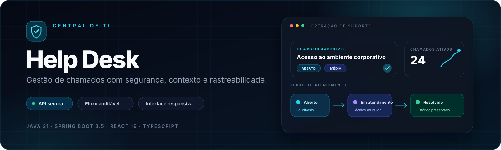
</p>

<p align="center">
  
  
  
  
</p>

<p align="center">
  
  
  
  
  
  
  
</p>

<p align="center">
  <strong>API REST segura, fluxo de atendimento rastreável e experiência responsiva para equipes de suporte.</strong>
</p>

<p align="center">
  <a href="#demonstração">Demonstração</a> ·
  <a href="#funcionalidades-por-perfil">Perfis</a> ·
  <a href="#arquitetura">Arquitetura</a> ·
  <a href="#executar-localmente-com-h2">Executar</a> ·
  <a href="#testes-e-qualidade">Testes</a> ·
  <a href="#api-principal">API</a>
</p>

## Sobre o projeto

O **Help Desk** é uma aplicação web full stack para organizar solicitações de TI do primeiro contato à resolução. O projeto reúne autenticação stateless, autorização por perfil e por chamado, regras explícitas de workflow, trilha de histórico e uma interface responsiva orientada à operação diária.

Mais do que um CRUD, o sistema demonstra decisões comuns em produtos corporativos:

- separação entre solicitantes, técnicos e administradores;
- transições de status validadas no backend;
- atribuição exclusiva a técnicos ativos;
- comentários e histórico vinculados ao usuário autenticado;
- exclusão lógica de chamados para preservar rastreabilidade;
- filtros, paginação, ordenação e indicadores calculados no banco;
- DTOs e respostas de erro que mantêm entidades e dados sensíveis fora do contrato público.

> [!IMPORTANT]
> O ambiente local com **H2 está validado**. A execução real das migrations e das consultas com **PostgreSQL ainda está pendente** e não é apresentada como concluída.

## Demonstração

Todas as imagens abaixo são **capturas reais da aplicação executada localmente**, com frontend React conectado à API Spring Boot e ao banco H2. Foram utilizadas somente contas e dados demonstrativos.

### Dashboard operacional

<p align="center">
  <a href="docs/images/03-dashboard.png">
    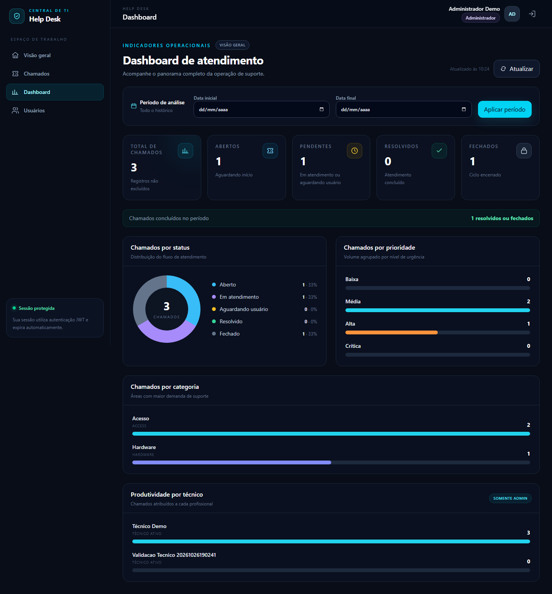
  </a>
</p>

### Login e página inicial

<p align="center">
  <a href="docs/images/01-login.png">
    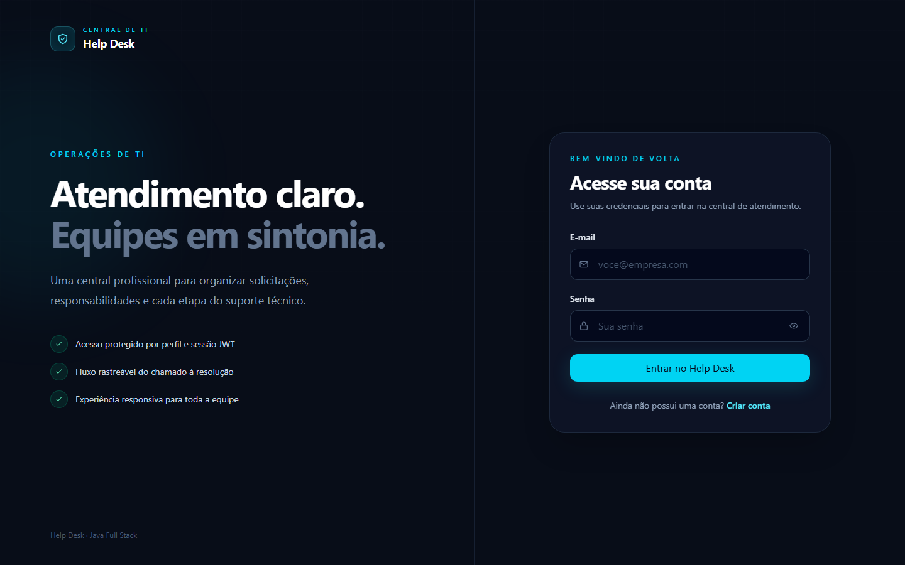
  </a>
</p>

<p align="center">
  <a href="docs/images/02-home.png">
    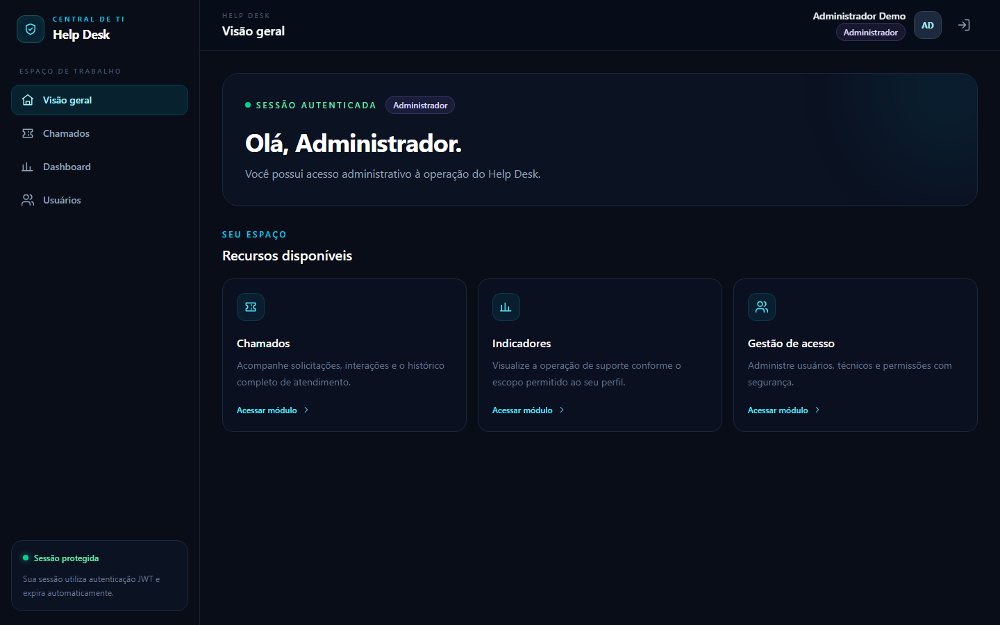
  </a>
</p>

### Gestão de chamados

<p align="center">
  <a href="docs/images/04-tickets.png">
    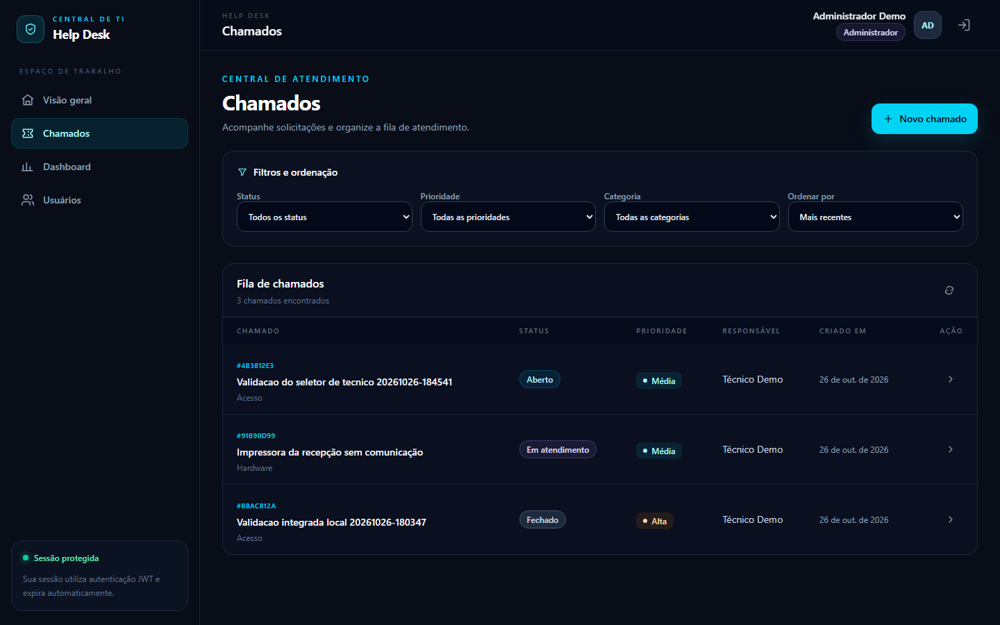
  </a>
</p>

### Detalhes, histórico e atribuição técnica

<p align="center">
  <a href="docs/images/05-ticket-details.png">
    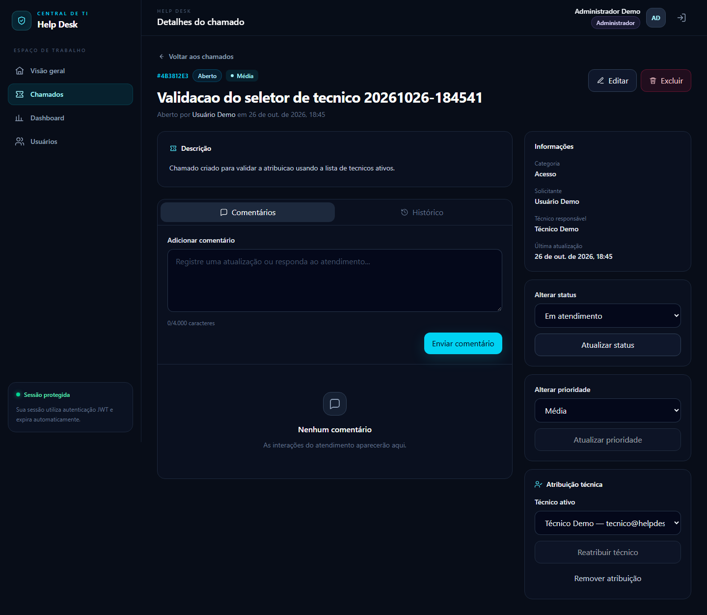
  </a>
</p>

<p align="center">
  <a href="docs/images/05-ticket-history.png">
    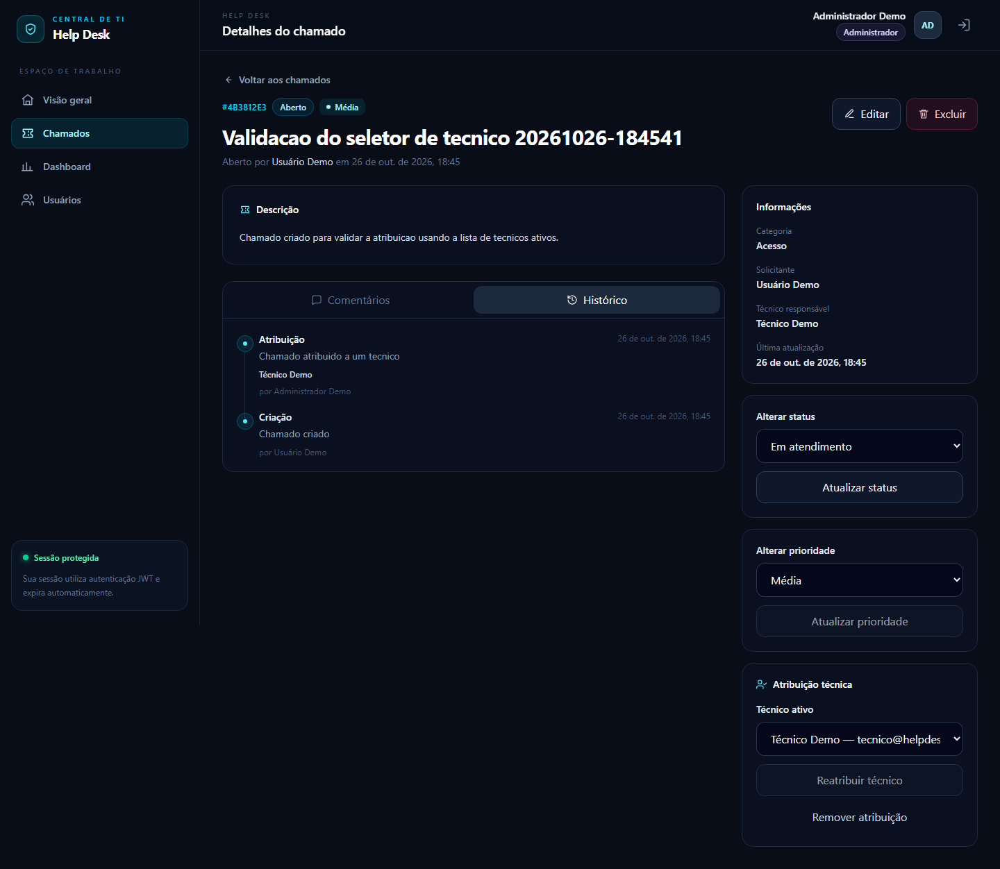
  </a>
</p>

### Gestão de usuários

<p align="center">
  <a href="docs/images/06-users.png">
    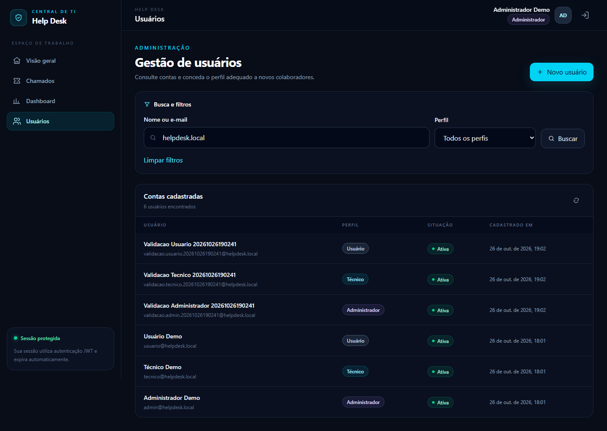
  </a>
</p>

## Funcionalidades por perfil

| Perfil | Escopo e ações principais |
| --- | --- |
| `ADMIN` | Visualiza a operação completa, administra usuários, abre e gerencia chamados, atribui técnicos ativos, altera status e prioridade e acompanha indicadores globais. |
| `TECNICO` | Atua nos chamados atribuídos, registra comentários, altera os dados permitidos, movimenta o workflow e consulta indicadores do próprio escopo. |
| `USUARIO` | Abre e acompanha os próprios chamados, edita ou exclui solicitações ainda abertas, comenta e confirma ou reabre uma resolução. |

A autorização é aplicada nas rotas e novamente nas regras de cada chamado. Solicitante, autor do comentário e responsável pela ação são derivados do JWT — o frontend não informa esses identificadores como fonte de confiança.

### Workflow do chamado

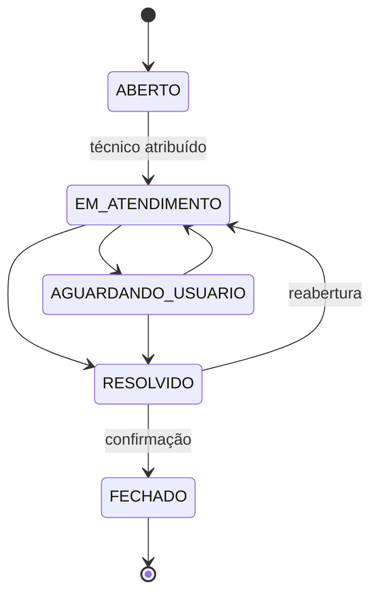

Status em atendimento, aguardando usuário ou resolvido exigem um técnico responsável. Chamados fechados não recebem novas alterações ou comentários.

## Arquitetura

<p align="center">
  <a href="docs/images/architecture.svg">
    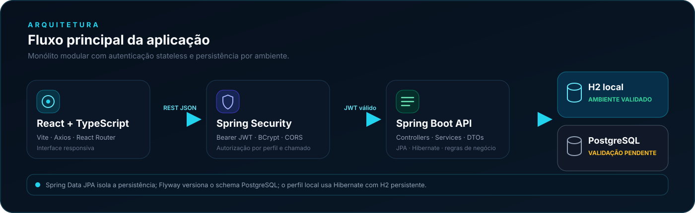
  </a>
</p>

O backend segue um **monólito modular por domínio**. Cada módulo separa API e DTOs, aplicação, modelo de domínio e persistência:

- `auth`: login, emissão e validação de JWT;
- `ticket`: chamados, categorias, comentários, histórico e workflow;
- `dashboard`: agregações e indicadores por escopo;
- `user`: usuários, perfis e técnicos disponíveis;
- `shared`: auditoria, paginação, exceções e infraestrutura comum.

No frontend, páginas e componentes reutilizáveis consomem uma camada de serviços HTTP. O Axios injeta o Bearer token nas chamadas protegidas, enquanto as rotas React limitam a navegação conforme o perfil.

## Autenticação e autorização JWT

1. O cliente envia e-mail e senha para `POST /api/v1/auth/login`.
2. O Spring Security autentica a conta no banco e verifica a senha com BCrypt.
3. A API emite um JWT HS256 com `uid`, nome, perfil, emissor e expiração.
4. O frontend mantém a sessão no `sessionStorage` e envia `Authorization: Bearer <token>`.
5. Filtros de segurança e regras de serviço validam perfil, propriedade e atribuição do chamado.
6. Respostas `401` limpam a sessão local e devolvem o usuário ao fluxo de autenticação.

O segredo JWT é obrigatório fora do perfil local. Senhas, hashes e token são protegidos contra exposição nos DTOs e em representações de log.

## Modelo de domínio

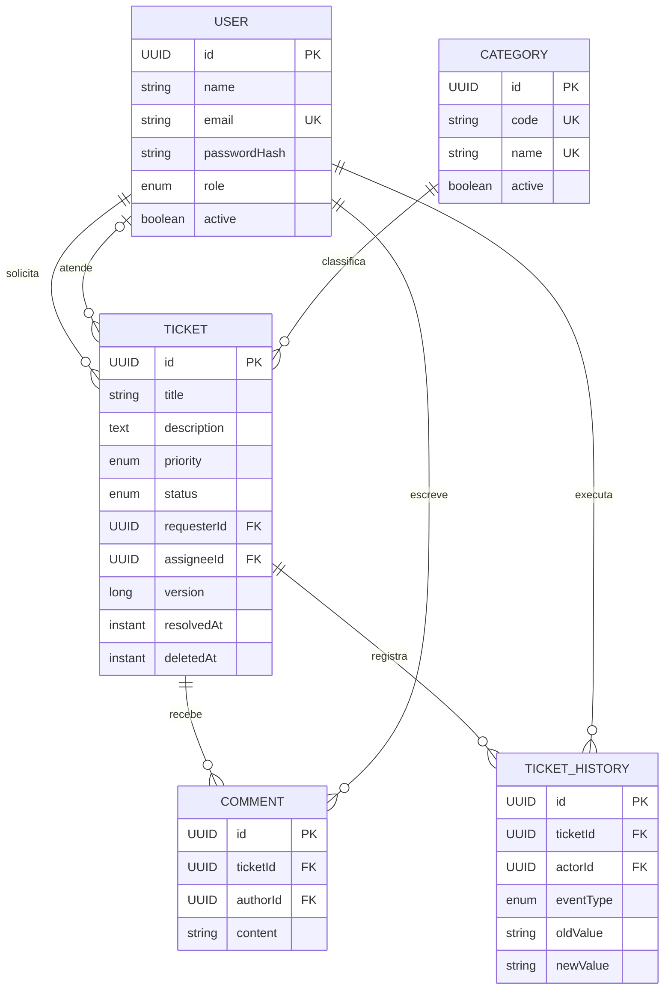

O campo de versão do chamado oferece suporte a concorrência otimista. `deletedAt` implementa exclusão lógica; comentários e eventos permanecem ligados ao chamado para compor sua linha do tempo.

## Stack tecnológica

| Camada | Tecnologias realmente utilizadas |
| --- | --- |
| Backend | Java 21, Spring Boot 3.5.16, Spring Web, Bean Validation |
| Segurança | Spring Security, OAuth2 Resource Server, JWT HS256, BCrypt |
| Persistência | Spring Data JPA, Hibernate, Flyway, PostgreSQL, H2 |
| Frontend | React 19.3, TypeScript 7.0, React Router 7.18, Axios 1.20 |
| UI e build | Tailwind CSS 4.3, Vite 8.3, CSS responsivo, SVG |
| API e qualidade | REST, OpenAPI/Swagger, JUnit 5, Mockito, Maven Wrapper |

## API principal

| Método | Rota | Finalidade | Acesso |
| --- | --- | --- | --- |
| `POST` | `/api/v1/auth/login` | Autenticar e emitir JWT | Público |
| `POST` | `/api/v1/auth/register` | Criar uma conta `USUARIO` | Público |
| `GET` | `/api/v1/categories` | Listar categorias ativas | Autenticado |
| `GET` / `POST` | `/api/v1/tickets` | Listar ou abrir chamados | Autenticado |
| `GET` / `PUT` / `DELETE` | `/api/v1/tickets/{id}` | Consultar, editar ou excluir logicamente | Conforme o chamado |
| `PUT` / `DELETE` | `/api/v1/tickets/{id}/assignee` | Atribuir ou remover técnico | `ADMIN` |
| `PATCH` | `/api/v1/tickets/{id}/status` | Executar transição de status | Conforme o workflow |
| `PATCH` | `/api/v1/tickets/{id}/priority` | Alterar prioridade | `ADMIN` ou técnico responsável |
| `GET` / `POST` | `/api/v1/tickets/{id}/comments` | Consultar ou adicionar comentários | Conforme o chamado |
| `GET` | `/api/v1/tickets/{id}/history` | Consultar a trilha de eventos | Conforme o chamado |
| `GET` | `/api/v1/dashboard/summary` | Obter indicadores por escopo e período | `ADMIN` ou `TECNICO` |
| `GET` / `POST` | `/api/v1/users` | Listar ou cadastrar usuários | `ADMIN` |
| `GET` | `/api/v1/users/technicians` | Listar técnicos ativos | `ADMIN` |

Com a aplicação em execução, o contrato interativo fica disponível em `http://localhost:8081/swagger-ui.html` no perfil local.

## Executar localmente com H2

O perfil `local` usa um H2 persistente em `backend/.data/helpdesk-local.mv.db`. O diretório é ignorado pelo Git, o Flyway fica desativado somente nesse perfil e o Hibernate mantém o schema local.

### Pré-requisitos

- JDK 21;
- Node.js 24 ou superior e npm;
- Git.

PostgreSQL e Docker **não são necessários** para o ambiente local.

### 1. Clonar o repositório

```bash
git clone https://github.com/geanrf/help-desk-java-fullstack.git
cd help-desk-java-fullstack
```

### 2. Iniciar o backend

Windows PowerShell:

```powershell
cd backend
.\mvnw.cmd spring-boot:run '-Dspring-boot.run.profiles=local'
```

Linux ou macOS:

```bash
cd backend
./mvnw spring-boot:run -Dspring-boot.run.profiles=local
```

### 3. Iniciar o frontend

Em outro terminal:

```bash
cd frontend
npm ci
npm run dev
```

### 4. Acessar

| Recurso | Endereço |
| --- | --- |
| Aplicação | `http://localhost:5174` |
| API local | `http://localhost:8081/api/v1` |
| Swagger UI | `http://localhost:8081/swagger-ui.html` |
| OpenAPI JSON | `http://localhost:8081/api-docs` |

### Contas demonstrativas

Estas contas são criadas de forma idempotente **somente** no perfil `local`:

| Perfil | E-mail | Senha local |
| --- | --- | --- |
| `ADMIN` | `admin@helpdesk.local` | `Admin@12345` |
| `TECNICO` | `tecnico@helpdesk.local` | `Tecnico@12345` |
| `USUARIO` | `usuario@helpdesk.local` | `Usuario@12345` |

As credenciais e o segredo JWT de fallback desse perfil são públicos e exclusivamente demonstrativos. Nunca os reutilize em outro ambiente.

## Configuração PostgreSQL

O perfil padrão está preparado para PostgreSQL e executa as migrations Flyway. Crie previamente o banco `helpdesk_db` e forneça as configurações por variáveis de ambiente — sem versionar credenciais.

```powershell
$env:DB_URL = 'jdbc:postgresql://localhost:5432/helpdesk_db'
$env:DB_USERNAME = 'helpdesk_app'
$env:DB_PASSWORD = '<defina-localmente>'
$env:JWT_SECRET = '<segredo-base64-com-pelo-menos-32-bytes>'
$env:JWT_ISSUER = 'help-desk-api'
$env:CORS_ALLOWED_ORIGINS = 'http://localhost:5174'

cd backend
.\mvnw.cmd spring-boot:run
```

Nesse perfil, a API usa a porta `8080`. Para o frontend local apontar para ela, crie um `frontend/.env.local` não versionado:

```dotenv
VITE_API_URL=/api/v1
VITE_PROXY_TARGET=http://localhost:8080
VITE_DEV_PORT=5174
```

O Flyway aplica:

- `V1__create_initial_schema.sql`: tabelas, relacionamentos, restrições e índices;
- `V2__seed_default_categories.sql`: categorias iniciais idempotentes.

> [!WARNING]
> A integração real com PostgreSQL ainda não foi validada. O próximo marco técnico é executar as migrations, o workflow e as consultas agregadas nesse banco.

## Testes e qualidade

Última validação conhecida em **27/10/2026**:

| Verificação | Resultado |
| --- | --- |
| Testes Java | **22 executados, 0 falhas, 0 erros, 0 ignorados** |
| TypeScript | `npm run typecheck` aprovado |
| Frontend | `npm run build` aprovado |
| Ambiente local | Login, navegação, dashboard, chamados, histórico, usuários e atribuição validados com H2 |

Backend:

```powershell
cd backend
.\mvnw.cmd test
```

Frontend:

```bash
cd frontend
npm run typecheck
npm run build
```

Os 22 testes Java cobrem regras de autorização, transições de status, criação de chamados com o usuário autenticado, agregações do dashboard, cadastro de usuários e proteção de DTOs sensíveis. Não há contagem fictícia de testes frontend: atualmente o frontend é verificado por typecheck e build de produção.

## Segurança

- senhas armazenadas exclusivamente como hash BCrypt;
- API stateless com expiração configurável do JWT;
- segredo JWT obrigatório fora do perfil local;
- cadastro público limitado ao perfil `USUARIO`;
- autorização por perfil, propriedade e atribuição;
- CORS configurável por ambiente;
- DTOs sem senha, hash ou token em logs;
- `.env`, bancos H2, dependências e artefatos de build ignorados pelo Git;
- exclusão lógica e trilha de histórico para preservar auditoria.

## Estrutura do repositório

```text
help-desk/
├── backend/                 # API Spring Boot e testes Java
│   └── src/main/java/com/geanrocha/helpdesk/
│       ├── auth/
│       ├── dashboard/
│       ├── ticket/
│       ├── user/
│       └── shared/
├── frontend/                # Aplicação React + TypeScript
│   └── src/
│       ├── api/
│       ├── app/
│       ├── auth/
│       ├── components/
│       ├── features/
│       └── pages/
└── docs/
    ├── capture-screenshots.mjs
    └── images/              # Banner, arquitetura e capturas reais
```

## Próximas evoluções

- validar PostgreSQL e migrations Flyway em ambiente autorizado;
- adicionar testes de integração com PostgreSQL isolado;
- automatizar testes de interface e acessibilidade;
- evoluir SLAs, notificações e filas por equipe;
- permitir anexos com política segura de armazenamento;
- adicionar observabilidade e pipeline de CI/CD.

## Autor

Desenvolvido por **Gean Rocha** como projeto de portfólio Java Full Stack.

- [GitHub](https://github.com/geanrf)
- [Repositório do projeto](https://github.com/geanrf/help-desk-java-fullstack)

## Estado do projeto

MVP funcional e validado localmente com H2, frontend integrado à API real, 22 testes Java aprovados e documentação visual baseada em capturas autênticas. A validação com PostgreSQL permanece explicitamente pendente.
