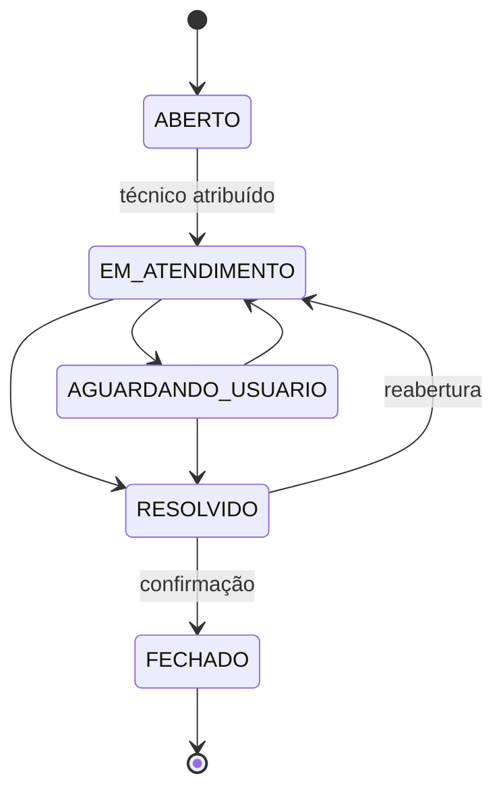
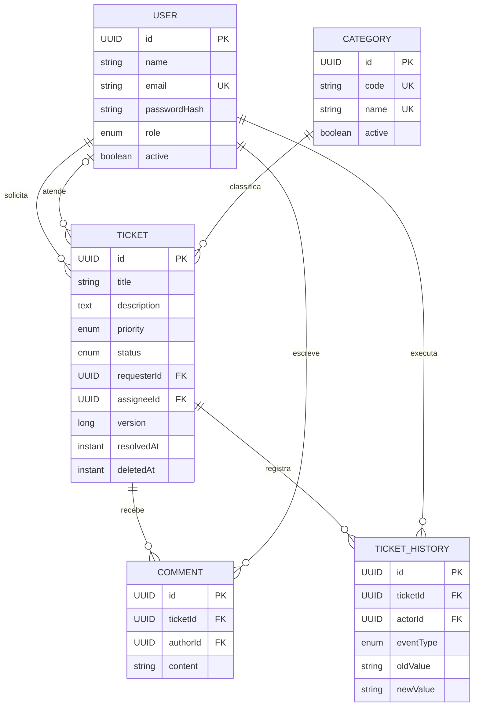

<p align="center">
  
</p>

<p align="center">
  
  
  
  
</p>

<p align="center">
  
  
  
  
  
  
  
</p>

<p align="center">
  <strong>API REST segura, fluxo de atendimento rastreável e experiência responsiva para equipes de suporte.</strong>
</p>

<p align="center">
  <a href="#demonstração">Demonstração</a> ·
  <a href="#funcionalidades-por-perfil">Perfis</a> ·
  <a href="#arquitetura">Arquitetura</a> ·
  <a href="#executar-com-postgresql-18">Executar</a> ·
  <a href="#testes-e-qualidade">Testes</a> ·
  <a href="#api-principal">API</a>
</p>

## Sobre o projeto

O **Help Desk** é uma aplicação web full stack para organizar solicitações de TI do primeiro contato à resolução. O projeto reúne autenticação stateless, autorização por perfil e por chamado, regras explícitas de workflow, trilha de histórico e uma interface responsiva orientada à operação diária.

Mais do que um CRUD, o sistema demonstra decisões comuns em produtos corporativos:

- separação entre solicitantes, técnicos e administradores;
- transições de status validadas no backend;
- atribuição exclusiva a técnicos ativos;
- comentários e histórico vinculados ao usuário autenticado;
- exclusão lógica de chamados para preservar rastreabilidade;
- filtros, paginação, ordenação e indicadores calculados no banco;
- DTOs e respostas de erro que mantêm entidades e dados sensíveis fora do contrato público.

> [!IMPORTANT]
> O fluxo principal foi validado de ponta a ponta com **PostgreSQL 18.1 real**: Flyway V1/V2, autenticação, permissões, usuários, chamados, comentários, histórico, dashboard e persistência após reinício. O H2 permanece como alternativa local isolada.

## Demonstração

Todas as imagens abaixo são **capturas reais da aplicação executada localmente**, com frontend React conectado à API Spring Boot e ao banco H2. Foram utilizadas somente contas e dados demonstrativos.

### Dashboard operacional

<p align="center">
  <a href="docs/images/03-dashboard.png">
    
  </a>
</p>

### Login e página inicial

<p align="center">
  <a href="docs/images/01-login.png">
    
  </a>
</p>

<p align="center">
  <a href="docs/images/02-home.png">
    
  </a>
</p>

### Gestão de chamados

<p align="center">
  <a href="docs/images/04-tickets.png">
    
  </a>
</p>

### Detalhes, histórico e atribuição técnica

<p align="center">
  <a href="docs/images/05-ticket-details.png">
    
  </a>
</p>

<p align="center">
  <a href="docs/images/05-ticket-history.png">
    
  </a>
</p>

### Gestão de usuários

<p align="center">
  <a href="docs/images/06-users.png">
    
  </a>
</p>

## Funcionalidades por perfil

| Perfil | Escopo e ações principais |
| --- | --- |
| `ADMIN` | Visualiza a operação completa, administra usuários, abre e gerencia chamados, atribui técnicos ativos, altera status e prioridade e acompanha indicadores globais. |
| `TECNICO` | Atua nos chamados atribuídos, registra comentários, altera os dados permitidos, movimenta o workflow e consulta indicadores do próprio escopo. |
| `USUARIO` | Abre e acompanha os próprios chamados, edita ou exclui solicitações ainda abertas, comenta e confirma ou reabre uma resolução. |

A autorização é aplicada nas rotas e novamente nas regras de cada chamado. Solicitante, autor do comentário e responsável pela ação são derivados do JWT — o frontend não informa esses identificadores como fonte de confiança.

### Workflow do chamado



Status em atendimento, aguardando usuário ou resolvido exigem um técnico responsável. Chamados fechados não recebem novas alterações ou comentários.

## Arquitetura

<p align="center">
  <a href="docs/images/architecture.svg">
    
  </a>
</p>

O backend segue um **monólito modular por domínio**. Cada módulo separa API e DTOs, aplicação, modelo de domínio e persistência:

- `auth`: login, emissão e validação de JWT;
- `ticket`: chamados, categorias, comentários, histórico e workflow;
- `dashboard`: agregações e indicadores por escopo;
- `user`: usuários, perfis e técnicos disponíveis;
- `shared`: auditoria, paginação, exceções e infraestrutura comum.

No frontend, páginas e componentes reutilizáveis consomem uma camada de serviços HTTP. O Axios injeta o Bearer token nas chamadas protegidas, enquanto as rotas React limitam a navegação conforme o perfil.

## Autenticação e autorização JWT

1. O cliente envia e-mail e senha para `POST /api/v1/auth/login`.
2. O Spring Security autentica a conta no banco e verifica a senha com BCrypt.
3. A API emite um JWT HS256 com `uid`, nome, perfil, emissor e expiração.
4. O frontend mantém a sessão no `sessionStorage` e envia `Authorization: Bearer <token>`.
5. Filtros de segurança e regras de serviço validam perfil, propriedade e atribuição do chamado.
6. Respostas `401` limpam a sessão local e devolvem o usuário ao fluxo de autenticação.

O segredo JWT é obrigatório fora do perfil local. Senhas, hashes e token são protegidos contra exposição nos DTOs e em representações de log.

## Modelo de domínio



O campo de versão do chamado oferece suporte a concorrência otimista. `deletedAt` implementa exclusão lógica; comentários e eventos permanecem ligados ao chamado para compor sua linha do tempo.

## Stack tecnológica

| Camada | Tecnologias realmente utilizadas |
| --- | --- |
| Backend | Java 21, Spring Boot 3.5.16, Spring Web, Bean Validation |
| Segurança | Spring Security, OAuth2 Resource Server, JWT HS256, BCrypt |
| Persistência | Spring Data JPA, Hibernate, Flyway, PostgreSQL, H2 |
| Frontend | React 19.3, TypeScript 7.0, React Router 7.18, Axios 1.20 |
| UI e build | Tailwind CSS 4.3, Vite 8.3, CSS responsivo, SVG |
| API e qualidade | REST, OpenAPI/Swagger, JUnit 5, Mockito, Maven Wrapper |

## API principal

| Método | Rota | Finalidade | Acesso |
| --- | --- | --- | --- |
| `POST` | `/api/v1/auth/login` | Autenticar e emitir JWT | Público |
| `POST` | `/api/v1/auth/register` | Criar uma conta `USUARIO` | Público |
| `GET` | `/api/v1/categories` | Listar categorias ativas | Autenticado |
| `GET` / `POST` | `/api/v1/tickets` | Listar ou abrir chamados | Autenticado |
| `GET` / `PUT` / `DELETE` | `/api/v1/tickets/{id}` | Consultar, editar ou excluir logicamente | Conforme o chamado |
| `PUT` / `DELETE` | `/api/v1/tickets/{id}/assignee` | Atribuir ou remover técnico | `ADMIN` |
| `PATCH` | `/api/v1/tickets/{id}/status` | Executar transição de status | Conforme o workflow |
| `PATCH` | `/api/v1/tickets/{id}/priority` | Alterar prioridade | `ADMIN` ou técnico responsável |
| `GET` / `POST` | `/api/v1/tickets/{id}/comments` | Consultar ou adicionar comentários | Conforme o chamado |
| `GET` | `/api/v1/tickets/{id}/history` | Consultar a trilha de eventos | Conforme o chamado |
| `GET` | `/api/v1/dashboard/summary` | Obter indicadores por escopo e período | `ADMIN` ou `TECNICO` |
| `GET` / `POST` | `/api/v1/users` | Listar ou cadastrar usuários | `ADMIN` |
| `PUT` | `/api/v1/users/{id}` | Editar perfil, situação e senha opcional | `ADMIN` |
| `GET` | `/api/v1/users/technicians` | Listar técnicos ativos | `ADMIN` |

Com a aplicação principal em execução, o contrato interativo fica disponível em `http://localhost:8080/swagger-ui.html`.

## Executar com PostgreSQL 18

Este é o fluxo principal e comprovado do projeto. O Spring Boot usa PostgreSQL por padrão, valida o schema com Hibernate e aplica as migrations com Flyway.

### Pré-requisitos

- JDK 21;
- Node.js 24 ou superior e npm;
- PostgreSQL 18 com o serviço ativo;
- banco `helpdesk_db` pertencente ao usuário `helpdesk_app`;
- Git.

O acesso local deve usar autenticação por senha, preferencialmente `scram-sha-256`. Não use `trust` no `pg_hba.conf`.

### 1. Iniciar o backend com prompt seguro

Na primeira execução, habilite explicitamente o bootstrap do ADMIN de desenvolvimento. O script solicita as senhas sem eco, mantém os valores apenas no processo e não cria `.env`:

```powershell
cd backend
powershell.exe -NoProfile -ExecutionPolicy Bypass -File .\scripts\Start-PostgresDev.ps1 -BootstrapAdmin -AdminEmail 'admin@helpdesk.dev'
```

O bootstrap existe somente no perfil `postgres-dev`, fica desabilitado por padrão e não possui senha de fallback. Se o e-mail já existir, nenhuma credencial é redefinida. Nas execuções seguintes:

```powershell
cd backend
powershell.exe -NoProfile -ExecutionPolicy Bypass -File .\scripts\Start-PostgresDev.ps1
```

Também é possível iniciar manualmente com variáveis de ambiente:

```powershell
$env:DB_URL = 'jdbc:postgresql://127.0.0.1:5432/helpdesk_db'
$env:DB_USERNAME = 'helpdesk_app'
$env:DB_PASSWORD = '<defina-somente-no-terminal-local>'
$env:JWT_SECRET = '<segredo-base64-com-pelo-menos-32-bytes>'
$env:JWT_ISSUER = 'help-desk-api'
$env:CORS_ALLOWED_ORIGINS = 'http://localhost:5174'
$env:SPRING_PROFILES_ACTIVE = 'postgres-dev'

cd backend
.\mvnw.cmd spring-boot:run
```

### 2. Iniciar o frontend

Em outro terminal, o proxy padrão já aponta para a API na porta 8080:

```bash
cd frontend
npm ci
npm run dev
```

### 3. Acessar

| Recurso | Endereço |
| --- | --- |
| Aplicação | `http://localhost:5174` |
| API PostgreSQL | `http://localhost:8080/api/v1` |
| Swagger UI | `http://localhost:8080/swagger-ui.html` |
| OpenAPI JSON | `http://localhost:8080/api-docs` |

O Flyway aplica e registra em `flyway_schema_history`:

- `V1__create_initial_schema.sql`: tabelas, relacionamentos, constraints e índices;
- `V2__seed_default_categories.sql`: cinco categorias iniciais.

> [!NOTE]
> A versão de Flyway gerenciada pelo Spring Boot 3.5.16 emite um aviso de que PostgreSQL 18 é mais novo que a faixa oficialmente testada por ela. Neste projeto, V1, V2, validação de schema, consultas JPA e reinício foram executados com sucesso no PostgreSQL 18.1.

## Executar localmente com H2

O perfil `local` continua disponível como alternativa rápida. Ele usa H2 persistente em `backend/.data/helpdesk-local.mv.db`, desativa Flyway somente nesse perfil e sobe a API na porta 8081:

```powershell
cd backend
.\mvnw.cmd spring-boot:run '-Dspring-boot.run.profiles=local'
```

Para usar o frontend com H2, defina `VITE_PROXY_TARGET=http://localhost:8081` em `frontend/.env.local`, arquivo ignorado pelo Git.

As contas abaixo são criadas **somente** no perfil `local` e nunca no perfil PostgreSQL ou em produção:

| Perfil | E-mail | Senha local |
| --- | --- | --- |
| `ADMIN` | `admin@helpdesk.local` | `Admin@12345` |
| `TECNICO` | `tecnico@helpdesk.local` | `Tecnico@12345` |
| `USUARIO` | `usuario@helpdesk.local` | `Usuario@12345` |

## Testes e qualidade

Última validação real em **28/10/2026**:

| Verificação | Resultado |
| --- | --- |
| PostgreSQL | **18.1**, `helpdesk_app` conectado e proprietário de `helpdesk_db` |
| Autenticação local | regras efetivas do `pg_hba.conf` em `scram-sha-256`, sem `trust` |
| Flyway | V1 e V2 aplicadas, validadas e estáveis após reinício |
| Schema | tabelas, FKs, checks, unicidades, índices e cinco categorias conferidos |
| Smoke test da API | **35 verificações HTTP aprovadas** |
| Persistência | ticket, 2 comentários e 11 eventos confirmados após reiniciar o backend |
| Testes Java | **23 executados, 0 falhas, 0 erros, 0 ignorados** |
| TypeScript | `npm run typecheck` aprovado |
| Frontend | `npm run build` aprovado; shell, proxy, login e dashboard responderam 200 |

O smoke test cobriu login `ADMIN`/`TECNICO`/`USUARIO`, criação e edição de usuários, criação/edição/soft delete de chamado, atribuição, prioridade, workflow, comentários, histórico, dashboard e respostas negativas `403`, `404` e `422`.

Backend:

```powershell
cd backend
.\mvnw.cmd clean test
```

Frontend:

```bash
cd frontend
npm run typecheck
npm run build
```

Os 23 testes Java cobrem regras de autorização, transições de status, criação de chamados com o usuário autenticado, agregações do dashboard, cadastro e edição de usuários e proteção de DTOs sensíveis. O frontend é verificado por typecheck, build de produção e integração HTTP real pelo proxy do Vite.

## Segurança

- senhas armazenadas exclusivamente como hash BCrypt;
- API stateless com expiração configurável do JWT;
- segredo JWT obrigatório fora do perfil local;
- bootstrap do ADMIN opt-in, restrito ao perfil `postgres-dev` e sem senha padrão;
- cadastro público limitado ao perfil `USUARIO`;
- autorização por perfil, propriedade e atribuição;
- CORS configurável por ambiente;
- DTOs sem senha, hash ou token em logs;
- `.env`, bancos H2, dependências e artefatos de build ignorados pelo Git;
- exclusão lógica e trilha de histórico para preservar auditoria.

## Estrutura do repositório

```text
help-desk/
├── backend/                 # API Spring Boot e testes Java
│   └── src/main/java/com/geanrocha/helpdesk/
│       ├── auth/
│       ├── dashboard/
│       ├── ticket/
│       ├── user/
│       └── shared/
├── frontend/                # Aplicação React + TypeScript
│   └── src/
│       ├── api/
│       ├── app/
│       ├── auth/
│       ├── components/
│       ├── features/
│       └── pages/
└── docs/
    ├── capture-screenshots.mjs
    └── images/              # Banner, arquitetura e capturas reais
```

## Próximas evoluções

- automatizar o smoke test PostgreSQL em ambiente isolado no CI;
- atualizar Flyway quando a versão gerenciada declarar suporte oficial ao PostgreSQL 18;
- automatizar testes de interface e acessibilidade;
- evoluir SLAs, notificações e filas por equipe;
- permitir anexos com política segura de armazenamento;
- adicionar observabilidade e pipeline de CI/CD.

## Autor

Desenvolvido por **Gean Rocha** como projeto de portfólio Java Full Stack.

- [GitHub](https://github.com/geanrf)
- [Repositório do projeto](https://github.com/geanrf/help-desk-java-fullstack)

## Estado do projeto

MVP full stack validado com PostgreSQL 18.1 real, Flyway V1/V2, frontend integrado, 23 testes Java, typecheck/build React e smoke test HTTP de 35 verificações. O H2 permanece apenas como alternativa local; a documentação visual continua baseada em capturas autênticas da aplicação.
