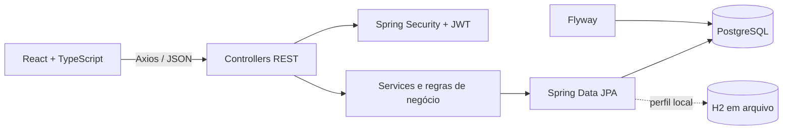

# Help Desk

Sistema profissional de gestão de chamados de TI desenvolvido como projeto de portfólio Java Full Stack. A aplicação combina uma API REST segura e stateless com uma interface React responsiva para solicitantes, técnicos e administradores.

## Funcionalidades

- Autenticação JWT com senhas protegidas por BCrypt.
- Perfis `ADMIN`, `TECNICO` e `USUARIO`.
- Abertura, consulta, edição permitida e exclusão lógica de chamados.
- Filtros, paginação e ordenação da fila de atendimento.
- Atribuição de técnicos ativos por meio de seleção administrativa.
- Fluxo controlado de status e prioridade.
- Comentários e histórico automático das alterações.
- Dashboard agregado por status, prioridade, categoria e técnico.
- Gestão administrativa de usuários com busca, filtros e cadastro.
- Layout escuro, responsivo e acessível.

## Perfis e permissões

| Perfil | Permissões principais |
| --- | --- |
| `ADMIN` | Visão geral da operação, gestão de usuários, atribuição de técnicos e administração dos chamados. |
| `TECNICO` | Atendimento dos chamados atribuídos, comentários, mudanças permitidas e indicadores próprios. |
| `USUARIO` | Abertura e acompanhamento dos próprios chamados, comentários e confirmações permitidas. |

A autorização é aplicada nas rotas e também no nível de cada chamado. O solicitante, o autor do comentário e o usuário responsável pela ação são obtidos do JWT, nunca de identificadores enviados pelo frontend.

## Arquitetura



O backend está organizado por domínio (`auth`, `ticket`, `dashboard`, `user`) e cada módulo separa API/DTOs, aplicação, domínio e persistência. O frontend organiza páginas, componentes reutilizáveis, autenticação, comunicação HTTP e funcionalidades por domínio.

### Decisões principais

- DTOs evitam a exposição direta das entidades JPA.
- Serviços transacionais concentram autorização e regras de negócio.
- Exclusão lógica preserva chamados e histórico.
- Consultas agregadas do dashboard são executadas no banco.
- Flyway controla o schema principal do PostgreSQL.
- H2 existe apenas para desenvolvimento local e não substitui a validação no PostgreSQL.

## Tecnologias

| Backend | Frontend | Dados e qualidade |
| --- | --- | --- |
| Java 21 | React 19 | PostgreSQL |
| Spring Boot 3.5 | TypeScript 7 | H2 local |
| Spring Security | Vite 8 | Flyway |
| Spring Data JPA | Tailwind CSS 4 | JUnit 5 e Mockito |
| JWT / OAuth2 Resource Server | React Router 7 | Maven Wrapper |
| Swagger / OpenAPI | Axios | Typecheck e build Vite |

## Modelo de domínio

- `User`: identidade, perfil e situação da conta.
- `Ticket`: título, descrição, categoria, prioridade, status, solicitante e técnico responsável.
- `Category`: classificação dos chamados.
- `Comment`: interação vinculada ao chamado e ao autor autenticado.
- `TicketHistory`: trilha auditável dos eventos relevantes.

## Estrutura do repositório

```text
help-desk/
├── backend/
│   ├── src/main/java/com/geanrocha/helpdesk/
│   ├── src/main/resources/db/migration/
│   ├── src/test/java/
│   ├── mvnw / mvnw.cmd
│   └── pom.xml
├── frontend/
│   ├── src/api/
│   ├── src/app/
│   ├── src/auth/
│   ├── src/components/
│   ├── src/features/
│   ├── src/pages/
│   └── package.json
├── docs/images/
└── README.md
```

## Executar localmente com H2

O perfil `local` usa um banco H2 persistente em `backend/.data/helpdesk-local.mv.db`. Esse diretório é ignorado pelo Git. O Flyway fica desativado somente nesse perfil e o Hibernate mantém o schema local.

### Pré-requisitos

- JDK 21.
- Node.js 24 ou superior e npm.
- Dependências Maven e npm disponíveis localmente ou acesso para baixá-las na primeira execução.

O Node portátil usado durante o desenvolvimento fica em `frontend/.tools`, mas não faz parte do repositório.

### Backend

Windows PowerShell:

```powershell
cd backend
.\mvnw.cmd spring-boot:run '-Dspring-boot.run.profiles=local'
```

Linux/macOS:

```bash
cd backend
./mvnw spring-boot:run -Dspring-boot.run.profiles=local
```

### Frontend

```bash
cd frontend
npm ci
npm run dev
```

Endereços locais:

- Frontend: `http://localhost:5174`
- API: `http://localhost:8081/api/v1`
- Swagger UI: `http://localhost:8081/swagger-ui.html`
- OpenAPI: `http://localhost:8081/api-docs`

### Contas demonstrativas

As contas abaixo são criadas de forma idempotente exclusivamente pelo perfil `local`:

| Perfil | E-mail | Senha de desenvolvimento |
| --- | --- | --- |
| `ADMIN` | `admin@helpdesk.local` | `Admin@12345` |
| `TECNICO` | `tecnico@helpdesk.local` | `Tecnico@12345` |
| `USUARIO` | `usuario@helpdesk.local` | `Usuario@12345` |

Essas credenciais e o segredo JWT de fallback do perfil local são públicos e demonstrativos. Nunca devem ser reutilizados em outro ambiente.

## Executar com PostgreSQL

PostgreSQL é o banco principal do projeto. Crie previamente um banco exclusivo `helpdesk_db` e um usuário de aplicação com privilégios somente nesse banco. Em seguida, forneça as configurações por variáveis de ambiente; não salve credenciais em arquivos versionados.

Exemplo no PowerShell:

```powershell
$env:DB_URL = 'jdbc:postgresql://localhost:5432/helpdesk_db'
$env:DB_USERNAME = 'helpdesk_app'
$env:DB_PASSWORD = '<defina localmente>'
$env:JWT_SECRET = '<segredo Base64 com pelo menos 32 bytes>'
$env:JWT_ISSUER = 'help-desk-api'
$env:CORS_ALLOWED_ORIGINS = 'http://localhost:5174'

cd backend
.\mvnw.cmd spring-boot:run
```

O Flyway executa automaticamente:

- `V1__create_initial_schema.sql`: tabelas, relacionamentos, restrições e índices.
- `V2__seed_default_categories.sql`: categorias iniciais idempotentes.

O PostgreSQL existente não é criado ou alterado fora dessas migrations. A execução real das migrations e das consultas agregadas em PostgreSQL ainda precisa ser validada em ambiente autorizado.

## Configuração do frontend

O arquivo `frontend/.env.example` documenta as variáveis públicas do Vite:

```dotenv
VITE_API_URL=/api/v1
VITE_PROXY_TARGET=http://localhost:8081
VITE_DEV_PORT=5174
```

Arquivos `.env` reais são ignorados. Variáveis prefixadas com `VITE_` são incorporadas ao bundle e não devem conter segredos.

## Testes e verificações

Backend:

```bash
cd backend
./mvnw test
```

No Windows, use `.\mvnw.cmd test`. A última validação local executou 22 testes com zero falhas.

Frontend:

```bash
cd frontend
npm run typecheck
npm run build
```

O fluxo ponta a ponta foi validado no H2 com login, abertura de chamado, atribuição, comentários, histórico, dashboard e cadastro administrativo de usuários.

## API principal

| Método e rota | Finalidade |
| --- | --- |
| `POST /api/v1/auth/login` | Autenticação e emissão do JWT. |
| `POST /api/v1/auth/register` | Cadastro público somente como `USUARIO`. |
| `GET /api/v1/users` | Lista administrativa paginada de usuários. |
| `POST /api/v1/users` | Cadastro de usuários por `ADMIN`. |
| `GET /api/v1/users/technicians` | Técnicos ativos disponíveis para atribuição. |
| `GET /api/v1/categories` | Categorias ativas. |
| `GET /api/v1/tickets`, `POST /api/v1/tickets` | Consulta paginada e abertura de chamados. |
| `GET`, `PUT` e `DELETE /api/v1/tickets/{id}` | Detalhes, edição permitida e exclusão lógica. |
| `PUT` e `DELETE /api/v1/tickets/{id}/assignee` | Atribuição ou remoção de técnico por `ADMIN`. |
| `PATCH /api/v1/tickets/{id}/status` | Transição validada de status. |
| `PATCH /api/v1/tickets/{id}/priority` | Alteração autorizada de prioridade. |
| `GET` e `POST /api/v1/tickets/{id}/comments` | Comentários paginados e inclusão autenticada. |
| `GET /api/v1/tickets/{id}/history` | Histórico paginado do chamado. |
| `GET /api/v1/dashboard/summary` | Indicadores por escopo e período. |

## Segurança

- JWT stateless e expiração configurável.
- Senhas armazenadas somente como hash BCrypt.
- Segredo JWT obrigatório fora do perfil local.
- Criação pública limitada ao perfil `USUARIO`.
- Endpoints administrativos protegidos por perfil.
- Autorização por propriedade e atribuição do chamado.
- DTOs sem senha, hash ou outros campos sensíveis.
- CORS configurável por ambiente.
- `.env`, bancos locais, caches e artefatos de build excluídos do Git.

## Capturas de tela

As imagens serão adicionadas em `docs/images` antes da apresentação final do portfólio:

| Arquivo planejado | Conteúdo |
| --- | --- |
| `login.png` | Tela de autenticação. |
| `tickets.png` | Listagem responsiva de chamados. |
| `ticket-details.png` | Atendimento, comentários e histórico. |
| `dashboard.png` | Indicadores e gráficos. |
| `users.png` | Gestão administrativa de usuários. |

Consulte [docs/images/README.md](docs/images/README.md) para o padrão recomendado das capturas.

## Estado do projeto

O MVP está funcional e validado localmente com H2. Para concluir a validação equivalente ao ambiente principal, ainda é necessário executar o backend contra o PostgreSQL exclusivo `helpdesk_db`, confirmar as migrations Flyway e repetir os testes de integração.
